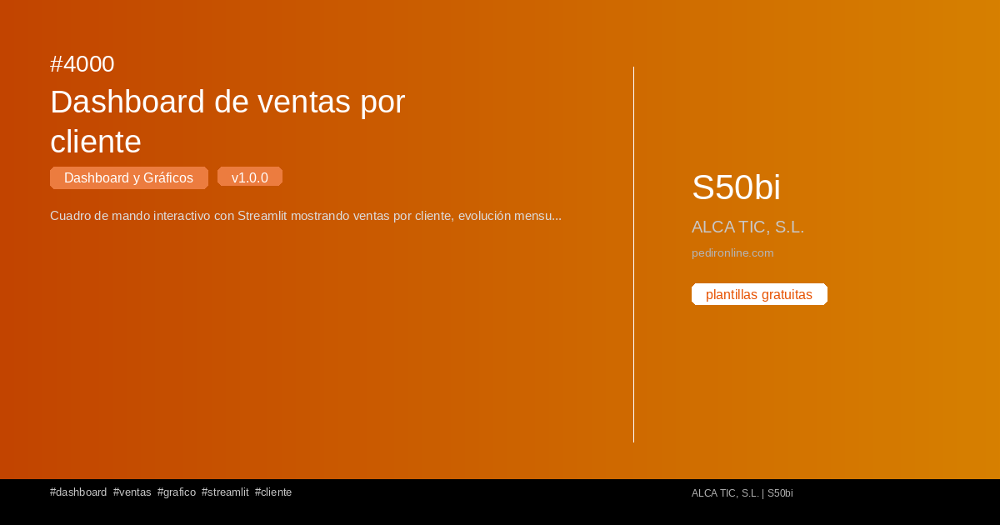
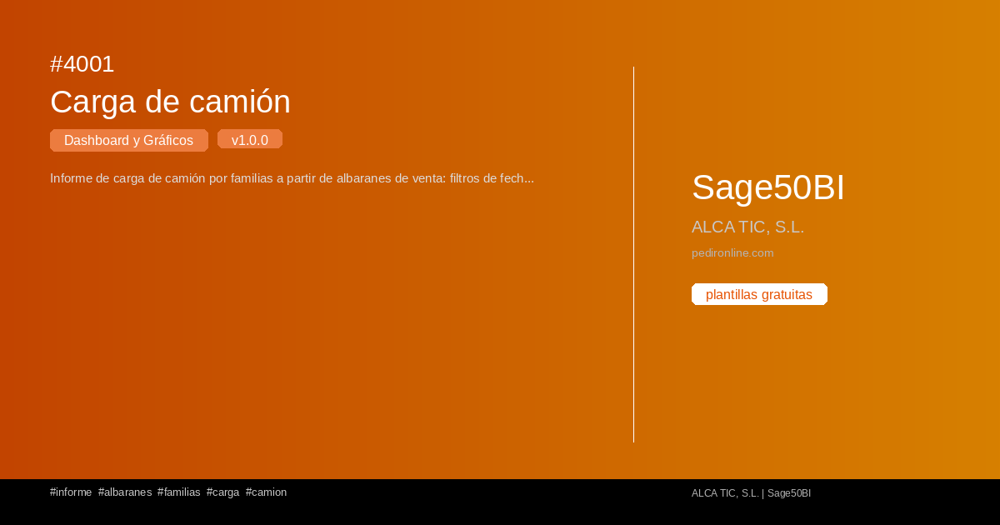
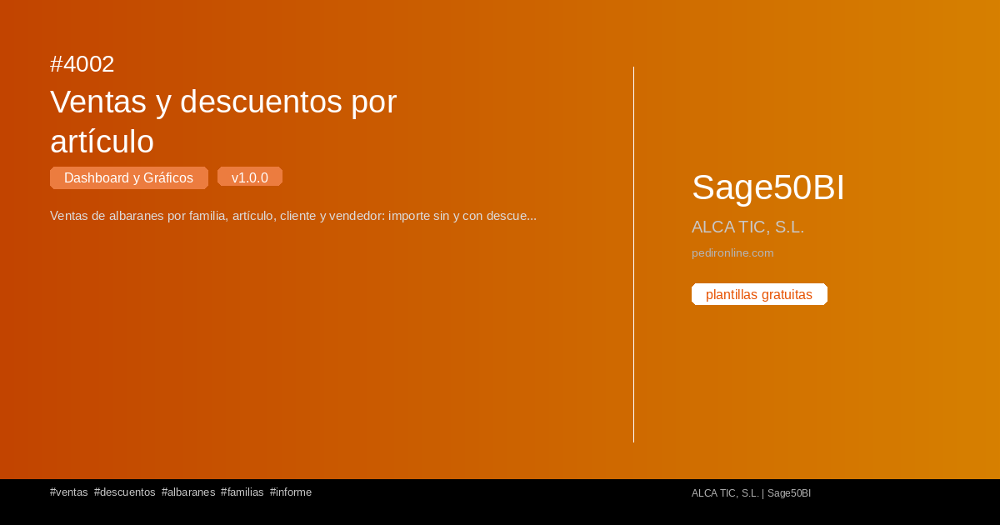
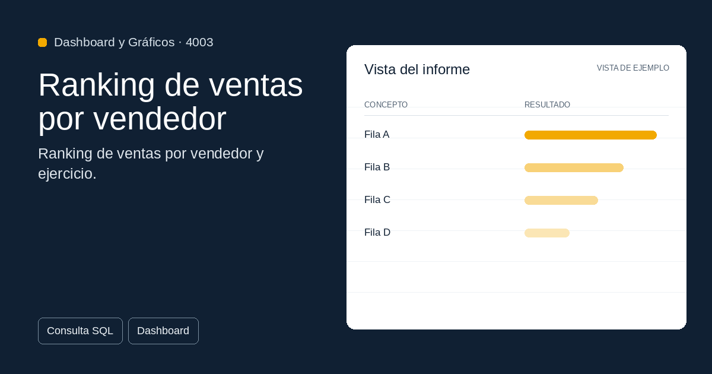
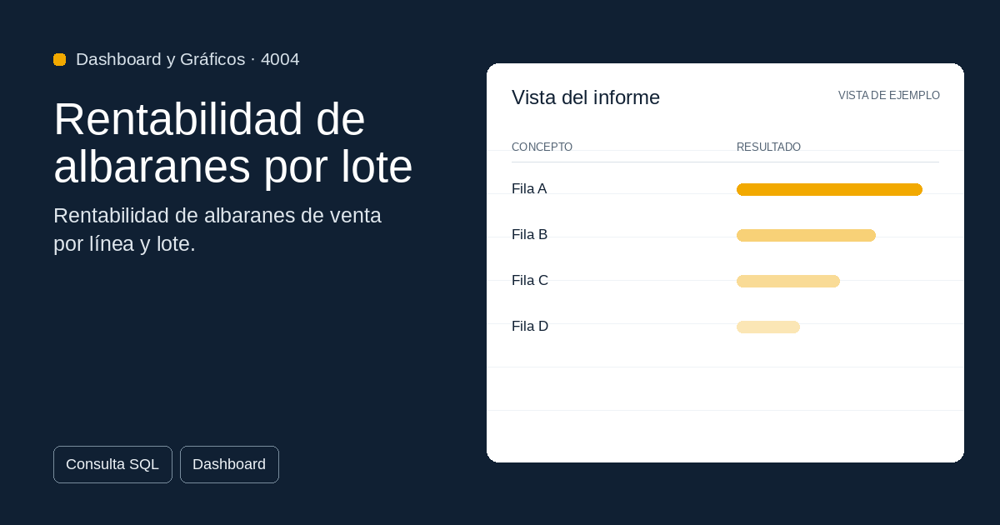
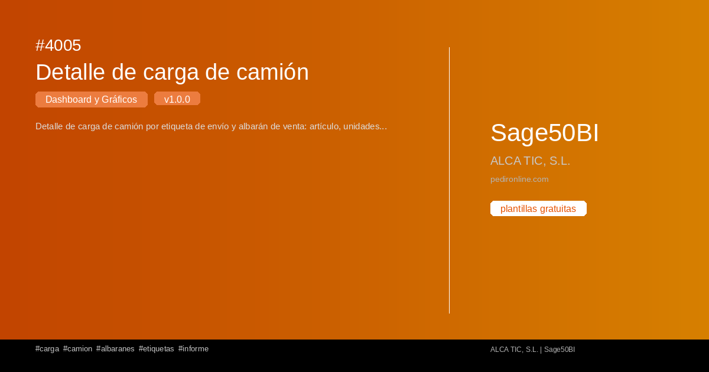

#  Tauler i Gràfics

Colección de plantilles de **Tauler i Gràfics** per a S50bi.

**6 plantilles disponibles**

## 4000 — Dashboard de ventas por cliente

{ loading=lazy width=1200 height=630 }

Cuadro de mando interactivo con Streamlit mostrando ventas por cliente, evolución mensual y top 10 clientes. Inclou gráficos de barras y líneas.

**Versió:** 1.0.0 | **Tags:** `dashboard` `ventas` `grafico` `streamlit`

[📄 Veure detall](../plantillas/4000-dashboard-de-ventas-por-cliente.md)

---

## 4001 — Carga de camión

{ loading=lazy width=1200 height=630 }

Informe de carga de camión por familias a partir de albaranes de venta: filtros de fecha, orden por código o nombre de familia y exportación a TXT imprimible y Excel.

**Versió:** 1.0.0 | **Tags:** `informe` `albaranes` `familias` `carga`

[📄 Veure detall](../plantillas/4001-carga-de-camion.md)

---

## 4002 — Ventas y descuentos por artículo

{ loading=lazy width=1200 height=630 }

Ventas de albaranes por familia, artículo, cliente y vendedor: importe sin y con descuento, descuento medio ponderado y descuento en euros.

**Versió:** 1.0.0 | **Tags:** `ventas` `descuentos` `albaranes` `familias`

[📄 Veure detall](../plantillas/4002-ventas-y-descuentos-por-articulo.md)

---

## 4003 — Ranking de ventas por vendedor

{ loading=lazy width=1200 height=630 }

Ranking de ventas por vendedor y ejercicio: pedidos, albaranes y total vendido sin IVA con posición por importe.

**Versió:** 1.0.0 | **Tags:** `ventas` `vendedores` `ranking` `pedidos`

[📄 Veure detall](../plantillas/4003-ranking-de-ventas-por-vendedor.md)

---

## 4004 — Rentabilidad de albaranes por lote

{ loading=lazy width=1200 height=630 }

Rentabilidad de albaranes de venta por línea y lote: importes, coste, beneficio y coste prorrateado por lote según peso o unidades.

**Versió:** 1.0.0 | **Tags:** `rentabilidad` `albaranes` `lotes` `costes`

[📄 Veure detall](../plantillas/4004-rentabilidad-de-albaranes-por-lote.md)

---

## 4005 — Detalle de carga de camión

{ loading=lazy width=1200 height=630 }

Detalle de carga de camión por etiqueta de envío y albarán de venta: artículo, unidades e importe cargado por documento.

**Versió:** 1.0.0 | **Tags:** `carga` `camion` `albaranes` `etiquetas`

[📄 Veure detall](../plantillas/4005-detalle-de-carga-de-camion.md)

---
