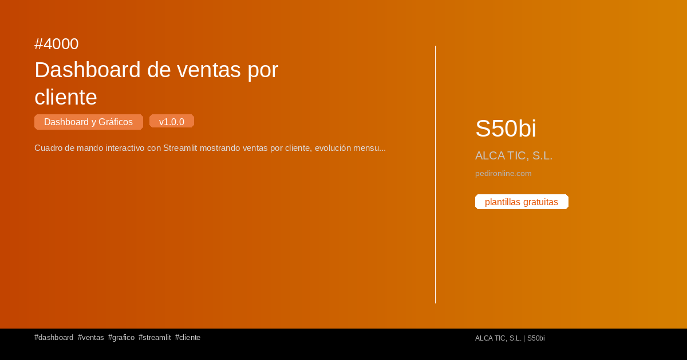

#  Dashboard y Gráficos

Colección de plantillas de **Dashboard y Gráficos** para Sage50BI.

**2 plantillas disponibles**

## 4000 — Dashboard de ventas por cliente

{ loading=lazy width=1200 height=630 }

Cuadro de mando interactivo con Streamlit mostrando ventas por cliente, evolución mensual y top 10 clientes. Incluye gráficos de barras y líneas.

**Versión:** 1.0.0 | **Tags:** `dashboard` `ventas` `grafico` `streamlit`

[📄 Ver detalle](../plantillas/4000-dashboard-de-ventas-por-cliente.md)

---

## 4001 — Carga de camión

{ loading=lazy width=1200 height=630 }

Informe de carga de camión por familias a partir de albaranes de venta: filtros de fecha, orden por código o nombre de familia y exportación a TXT imprimible y Excel.

**Versión:** 1.0.0 | **Tags:** `informe` `albaranes` `familias` `carga`

[📄 Ver detalle](../plantillas/4001-carga-de-camion.md)

---
