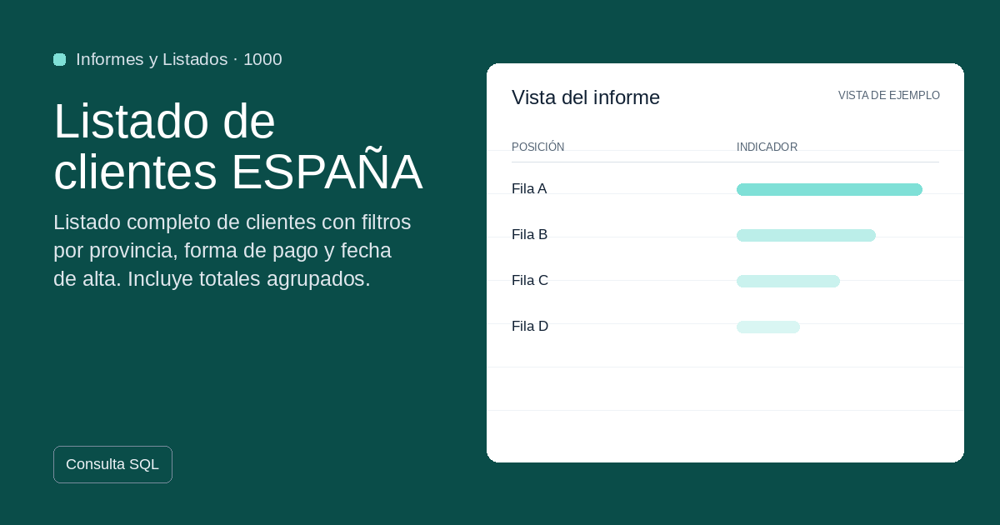
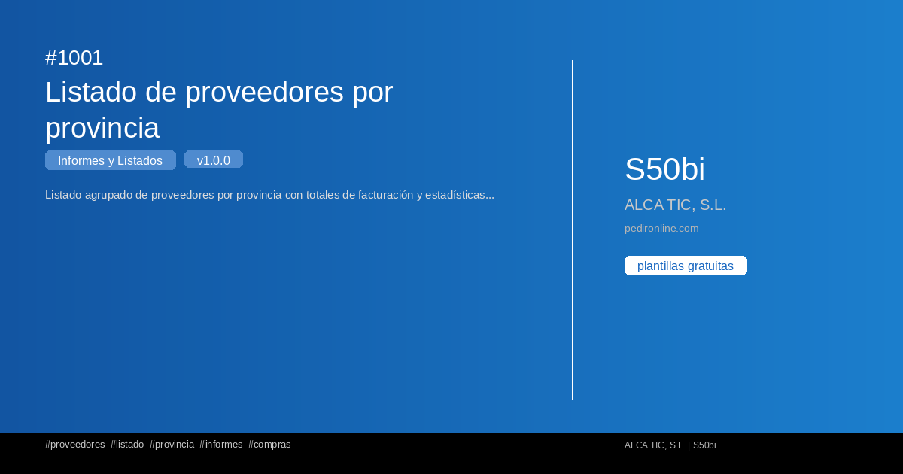

#  Informes i Llistats

Colección de plantilles de **Informes i Llistats** per a Sage50BI.

**2 plantilles disponibles**

## 1000 — Listado de clientes ESPAÑA

{ loading=lazy width=1200 height=630 }

Listado completo de clientes con filtros por provincia, forma de pago y fecha de alta. Inclou totales agrupados.

**Versió:** 1.0.0 | **Tags:** `clientes` `listado` `españa` `informes`

[📄 Veure detall](../plantillas/1000-listado-de-clientes-espana.md)

---

## 1001 — Listado de proveedores por provincia

{ loading=lazy width=1200 height=630 }

Listado agrupado de proveedores por provincia con totales de facturación y estadísticas de compra.

**Versió:** 1.0.0 | **Tags:** `proveedores` `listado` `provincia` `informes`

[📄 Veure detall](../plantillas/1001-listado-de-proveedores-por-provincia.md)

---
