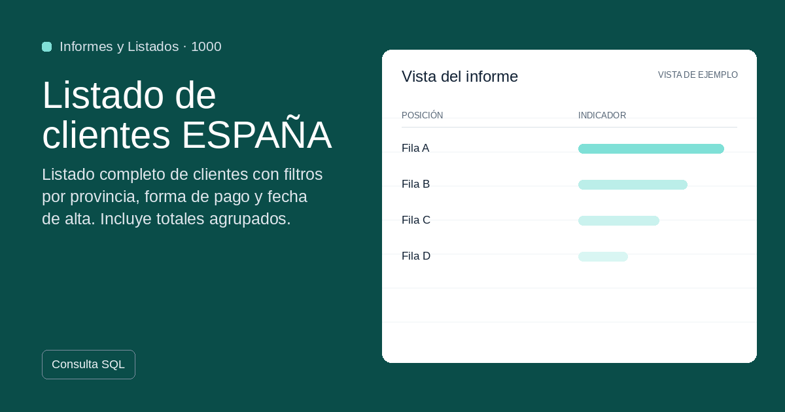
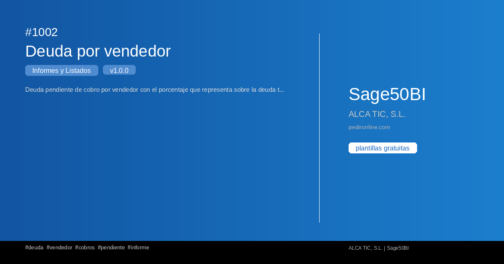
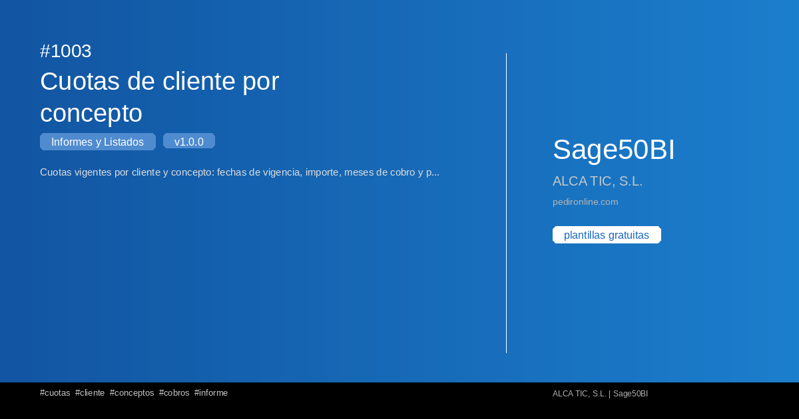
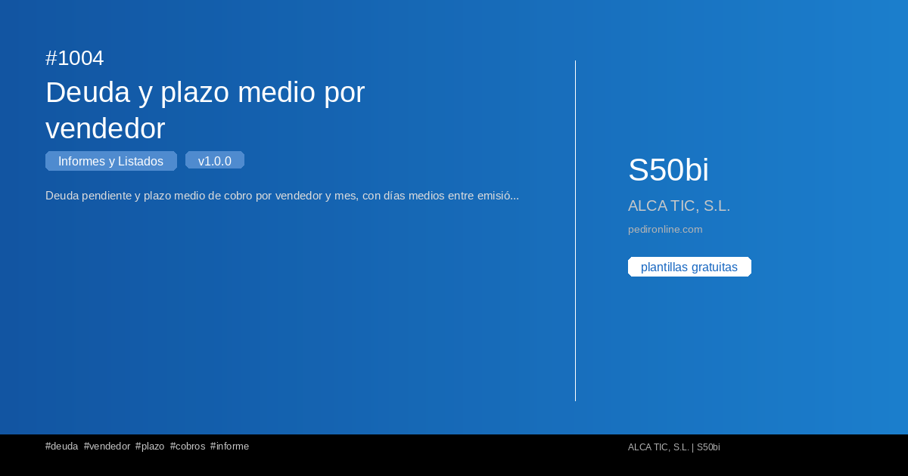

#  Informes y Listados

Colección de plantillas de **Informes y Listados** para S50bi.

**5 plantillas disponibles**

## 1000 — Listado de clientes ESPAÑA

{ loading=lazy width=1200 height=630 }

Listado completo de clientes con filtros por provincia, forma de pago y fecha de alta. Incluye totales agrupados.

**Versión:** 1.0.0 | **Tags:** `clientes` `listado` `españa` `informes`

[📄 Ver detalle](../plantillas/1000-listado-de-clientes-espana.md)

---

## 1001 — Listado de proveedores por provincia

{ loading=lazy width=1200 height=630 }

Listado agrupado de proveedores por provincia con totales de facturación y estadísticas de compra.

**Versión:** 1.0.0 | **Tags:** `proveedores` `listado` `provincia` `informes`

[📄 Ver detalle](../plantillas/1001-listado-de-proveedores-por-provincia.md)

---

## 1002 — Deuda por vendedor

{ loading=lazy width=1200 height=630 }

Deuda pendiente de cobro por vendedor con el porcentaje que representa sobre la deuda total de la empresa.

**Versión:** 1.0.0 | **Tags:** `deuda` `vendedor` `cobros` `pendiente`

[📄 Ver detalle](../plantillas/1002-deuda-por-vendedor.md)

---

## 1003 — Cuotas de cliente por concepto

{ loading=lazy width=1200 height=630 }

Cuotas vigentes por cliente y concepto: fechas de vigencia, importe, meses de cobro y periodicidad en meses.

**Versión:** 1.0.0 | **Tags:** `cuotas` `cliente` `conceptos` `cobros`

[📄 Ver detalle](../plantillas/1003-cuotas-de-cliente-por-concepto.md)

---

## 1004 — Deuda y plazo medio por vendedor

{ loading=lazy width=1200 height=630 }

Deuda pendiente y plazo medio de cobro por vendedor y mes, con días medios entre emisión y cobro.

**Versión:** 1.0.0 | **Tags:** `deuda` `vendedor` `plazo` `cobros`

[📄 Ver detalle](../plantillas/1004-deuda-y-plazo-medio-por-vendedor.md)

---
