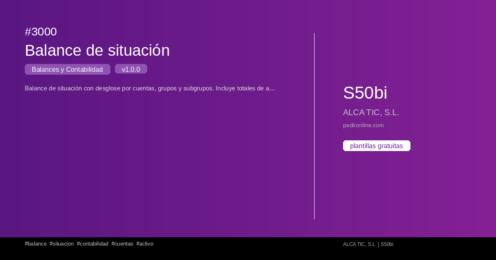
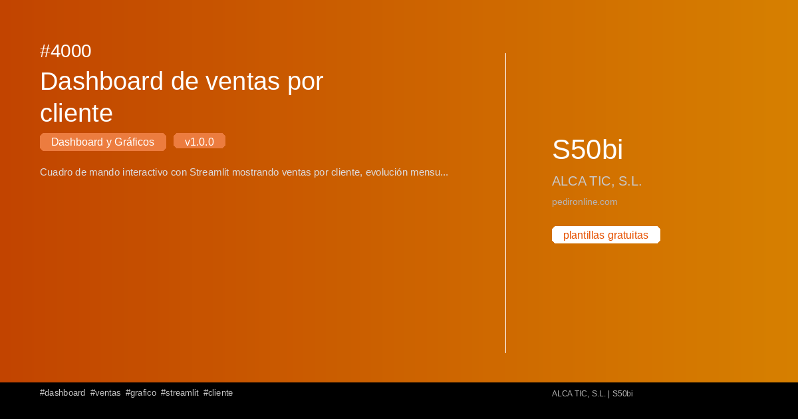
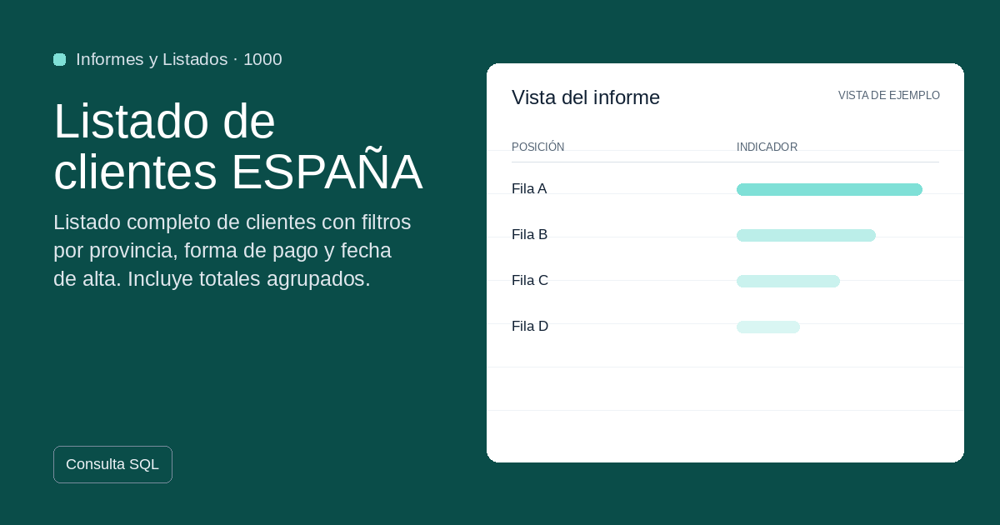
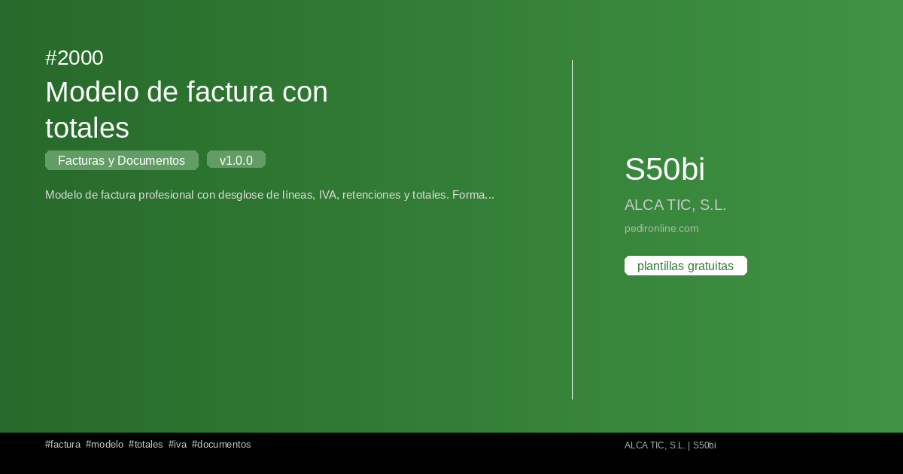
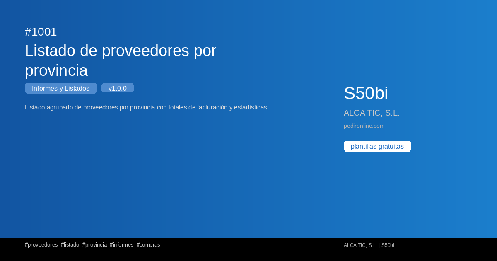

<!--
CONTRACT: Sage50BI portal — The Spreadsheet (seed b3a2cf0c)
THESIS: The catalog as a live spreadsheet: every template is a cell that opens.
OWN-WORLD: Teal and amber on paper-light surfaces, ruled sheet grids, column-header color bands, tabular totals; platform display sans over system text.
STORY: A Sage 50 user lands on a familiar ledger: categories read as column headers, templates as rows to open, install, adapt.
FIRST VIEWPORT: A dark teal ruled sheet with a headline and a totals row above the fold; the four category bands below as column headers.
FORM: The Spreadsheet, position 6 of 7 grounded directions, seed key b3a2cf0c.
FINISH: unreviewed and undocumented is unfinished; this build ends with the finish review, the verdict, and DESIGN.md
-->

<section class="sage-hero" markdown="1">

Portal públic de plantilles per a Sage50BI

# Converteix Sage 50 en un quadre de comandament útil des del primer dia

Sage50BI reuneix <strong>plantilles gratuïtes</strong> d'informes, facturació, comptabilitat i dashboards perquè una empresa pugui consultar les dades de Sage 50 sense desenvolupar cada llistat des de zero.

Sense registre, sense cost i llestes per instal·lar des de Sage50BI.

<a class="sage-button sage-button--primary" href="#cataleg-tecnic-ultimes-plantilles">Veure catàleg de plantilles</a>
<a class="sage-button sage-button--secondary" href="#contacto">Sol·licitar una adaptació a mida</a>

Requisit: necessites tenir <strong>Sage50BI</strong> instal·lat al teu Sage 50 per instal·lar aquestes plantilles. <a href="https://github.com/alfonsoautomatiza/Sage50bi/releases/latest/download/Sage50bi.exe">Descarregar Sage50BI</a>

<strong>6</strong>plantilles llestes
<strong>2</strong>paquets de treball
<strong>Adaptació</strong>a mida

<aside class="sage-hero__panel" markdown="1">

<svg class="sage-hero__illustration" viewBox="0 0 290 160" fill="none" xmlns="http://www.w3.org/2000/svg" aria-hidden="true" focusable="false">
<rect x="1" y="1" width="288" height="158" rx="14" fill="rgba(255,255,255,0.06)" stroke="rgba(255,255,255,0.14)"/>
<rect x="8" y="8" width="64" height="24" rx="6" fill="#0f6f68"/>
<rect x="78" y="8" width="64" height="24" rx="6" fill="#f2a900"/>
<rect x="148" y="8" width="64" height="24" rx="6" fill="#243c7a"/>
<rect x="218" y="8" width="64" height="24" rx="6" fill="#7c3aed"/>
<rect x="18" y="18" width="30" height="4" rx="2" fill="rgba(255,255,255,0.92)"/>
<rect x="88" y="18" width="26" height="4" rx="2" fill="rgba(255,255,255,0.92)"/>
<rect x="158" y="18" width="34" height="4" rx="2" fill="rgba(255,255,255,0.92)"/>
<rect x="228" y="18" width="24" height="4" rx="2" fill="rgba(255,255,255,0.92)"/>
<rect x="8" y="42" width="64" height="26" rx="5" fill="rgba(255,255,255,0.08)"/>
<rect x="148" y="42" width="64" height="26" rx="5" fill="rgba(255,255,255,0.08)"/>
<rect x="218" y="42" width="64" height="26" rx="5" fill="rgba(255,255,255,0.08)"/>
<rect x="18" y="53" width="34" height="4" rx="2" fill="rgba(255,255,255,0.32)"/>
<rect x="158" y="53" width="24" height="4" rx="2" fill="rgba(255,255,255,0.32)"/>
<rect x="228" y="53" width="30" height="4" rx="2" fill="rgba(255,255,255,0.32)"/>
<rect x="76" y="40" width="68" height="30" rx="6" fill="rgba(242,169,0,0.16)" stroke="#f2a900" stroke-width="1.5"/>
<rect x="88" y="53" width="28" height="4" rx="2" fill="rgba(255,255,255,0.55)"/>
<circle cx="132" cy="47" r="7" fill="#f2a900"/>
<path d="M129 47.2 131.2 49.4 135.4 44.6" stroke="#102033" stroke-width="1.6" stroke-linecap="round" stroke-linejoin="round" fill="none"/>
<rect x="8" y="76" width="64" height="26" rx="5" fill="rgba(255,255,255,0.08)"/>
<rect x="78" y="76" width="64" height="26" rx="5" fill="rgba(255,255,255,0.08)"/>
<rect x="148" y="76" width="64" height="26" rx="5" fill="rgba(255,255,255,0.08)"/>
<rect x="218" y="76" width="64" height="26" rx="5" fill="rgba(255,255,255,0.08)"/>
<rect x="18" y="87" width="26" height="4" rx="2" fill="rgba(255,255,255,0.28)"/>
<rect x="88" y="87" width="32" height="4" rx="2" fill="rgba(255,255,255,0.28)"/>
<rect x="158" y="87" width="22" height="4" rx="2" fill="rgba(255,255,255,0.28)"/>
<rect x="228" y="87" width="28" height="4" rx="2" fill="rgba(255,255,255,0.28)"/>
<rect x="8" y="110" width="274" height="30" rx="6" fill="rgba(255,255,255,0.16)"/>
<rect x="18" y="122" width="34" height="5" rx="2.5" fill="rgba(255,255,255,0.85)"/>
<rect x="88" y="122" width="28" height="5" rx="2.5" fill="rgba(255,255,255,0.85)"/>
<rect x="158" y="122" width="30" height="5" rx="2.5" fill="rgba(255,255,255,0.85)"/>
<path d="M236 130 L246 114 L256 130 Z" fill="#ffd166"/>
</svg>

### De la dada de Sage 50 a una decisió de negoci

Llistats, consultes SQL i dashboards preparats per instal·lar des de Sage50BI.

`Sage 50` + `Sage50BI` + `Plantillas SQL`
</aside>
</section>

<section class="sage-section sage-section--showcase" markdown="1">
## Aparador de plantilles

Totes les plantilles públiques d'un cop d'ull: explora cada una i instal·la-la des de Sage50BI.

<article class="sage-carousel__card" markdown="1">

### [Carga de camión](plantillas/4001-carga-de-camion.md)
</article>
<article class="sage-carousel__card" markdown="1">

### [Balance de situación](plantillas/3000-balance-de-situacion.md)
</article>
<article class="sage-carousel__card" markdown="1">

### [Dashboard de ventas por cliente](plantillas/4000-dashboard-de-ventas-por-cliente.md)
</article>
<article class="sage-carousel__card" markdown="1">

### [Listado de clientes ESPAÑA](plantillas/1000-listado-de-clientes-espana.md)
</article>
<article class="sage-carousel__card" markdown="1">

### [Modelo de factura con totales](plantillas/2000-modelo-de-factura-con-totales.md)
</article>
<article class="sage-carousel__card" markdown="1">

### [Listado de proveedores por provincia](plantillas/1001-listado-de-proveedores-por-provincia.md)
</article>

</section>

<section class="sage-section sage-section--business" markdown="1">
## Què resol

<a class="sage-business-tile" href="categorias/informes-listados.md">
1000-1999
<strong>Vendes</strong>
Detecta clients, articles i operacions que necessiten seguiment comercial.
</a>
<a class="sage-business-tile" href="categorias/facturas-documentos.md">
2000-2999
<strong>Facturació</strong>
Revisa documents, venciments i imports sense reconstruir informes manualment.
</a>
<a class="sage-business-tile" href="categorias/balances-contabilidad.md">
3000-3999
<strong>Comptabilitat</strong>
Consulta balanços i senyals financers amb una lectura més directa.
</a>
<a class="sage-business-tile" href="categorias/dashboards-graficos.md">
4000-4999
<strong>Dashboards</strong>
Converteix consultes en panells visuals per a direcció, administració i equips.
</a>

</section>

<section class="sage-section" markdown="1">
## Plantilles recomanades per començar

Una entrada ràpida al catàleg: peces útils per validar el valor de Sage50BI abans de demanar una adaptació.

<article class="sage-featured-card" markdown="1">
#4000
### [Dashboard de ventas por cliente](plantillas/4000-dashboard-de-ventas-por-cliente.md)

Dashboards i Gràfics

Cuadro de mando interactivo con Streamlit mostrando ventas por cliente, evolución mensual y top 10 clientes. Incluye gráficos de b...

[**Veure detall**](plantillas/4000-dashboard-de-ventas-por-cliente.md)
</article>
<article class="sage-featured-card" markdown="1">
#2000
### [Modelo de factura con totales](plantillas/2000-modelo-de-factura-con-totales.md)

Factures i Documents

Modelo de factura profesional con desglose de líneas, IVA, retenciones y totales. Formato optimizado para impresión.

[**Veure detall**](plantillas/2000-modelo-de-factura-con-totales.md)
</article>
<article class="sage-featured-card" markdown="1">
#3000
### [Balance de situación](plantillas/3000-balance-de-situacion.md)

Balanços i Comptabilitat

Balance de situación con desglose por cuentas, grupos y subgrupos. Incluye totales de activo, pasivo y patrimonio neto.

[**Veure detall**](plantillas/3000-balance-de-situacion.md)
</article>
<article class="sage-featured-card" markdown="1">
#4001
### [Carga de camión](plantillas/4001-carga-de-camion.md)

Dashboards i Gràfics

Informe de carga de camión por familias a partir de albaranes de venta: filtros de fecha, orden por código o nombre de familia y e...

[**Veure detall**](plantillas/4001-carga-de-camion.md)
</article>

</section>

<section class="sage-section sage-section--packs" markdown="1">
## Paquets destacats

Agrupa plantilles per flux de treball per instal·lar diverses peces coherents alhora.

<article class="sage-pack-card" markdown="1">
### [Pack Contabilidad Completa](packs/pack-contabilidad-completa.md)

Balances y dashboard.

2 plantilles
</article>
<article class="sage-pack-card" markdown="1">
### [Pack Gestión Comercial](packs/pack-gestion-comercial.md)

Todo lo que necesitas para gestionar clientes, proveedores y facturas en Sage50BI.

3 plantilles
</article>

</section>

<section class="sage-section sage-section--technical" markdown="1">
## Catàleg tècnic: últimes plantilles

La documentació tècnica continua disponible: versió, categoria i descripció curta de les últimes publicacions.

| # | Plantilla | Àrea | Versió | Descripció |
|---|-----------|-----------|---------|-------------|
| 4001 | [Carga de camión](plantillas/4001-carga-de-camion.md) |  Dashboards i Gràfics | 1.0.0 | Informe de carga de camión por familias a partir de albarane... |
| 3000 | [Balance de situación](plantillas/3000-balance-de-situacion.md) |  Balanços i Comptabilitat | 1.0.0 | Balance de situación con desglose por cuentas, grupos y subg... |
| 4000 | [Dashboard de ventas por cliente](plantillas/4000-dashboard-de-ventas-por-cliente.md) |  Dashboards i Gràfics | 1.0.0 | Cuadro de mando interactivo con Streamlit mostrando ventas p... |
| 1000 | [Listado de clientes ESPAÑA](plantillas/1000-listado-de-clientes-espana.md) |  Informes i Llistats | 1.0.0 | Listado completo de clientes con filtros por provincia, form... |
| 2000 | [Modelo de factura con totales](plantillas/2000-modelo-de-factura-con-totales.md) |  Factures i Documents | 1.0.0 | Modelo de factura profesional con desglose de líneas, IVA, r... |
| 1001 | [Listado de proveedores por provincia](plantillas/1001-listado-de-proveedores-por-provincia.md) |  Informes i Llistats | 1.0.0 | Listado agrupado de proveedores por provincia con totales de... |
</section>

<section class="sage-section sage-section--split" markdown="1">

## Explorar per àrea

Entra per l'àrea que vulguis millorar primer i baixa al detall de cada plantilla.

| Icona | Àrea | Rang |
|-------|-----------|-------|
|  | [Informes i Llistats](categorias/informes-listados.md) | 1000-1999 |
|  | [Factures i Documents](categorias/facturas-documentos.md) | 2000-2999 |
|  | [Balanços i Comptabilitat](categorias/balances-contabilidad.md) | 3000-3999 |
|  | [Dashboards i Gràfics](categorias/dashboards-graficos.md) | 4000-4999 |

## Com funciona

<article class="sage-step" markdown="1">
1
### Descarrega Sage50BI

Instal·la Sage50BI al teu Sage 50 si encara no el tens: és el requisit previ per poder instal·lar qualsevol plantilla. [Descarregar Sage50BI](https://github.com/alfonsoautomatiza/Sage50bi/releases/latest/download/Sage50bi.exe)
</article>
<article class="sage-step" markdown="1">
2
### Tria

Explora el catàleg públic o comença per una plantilla recomanada.
</article>
<article class="sage-step" markdown="1">
3
### Instal·la

Sage50BI llegeix el manifest del repositori, descarrega la plantilla xifrada i la deixa llesta per utilitzar.
</article>
<article class="sage-step" markdown="1">
4
### Adapta

Adaptem consultes, dashboards i paquets a les necessitats concretes de la teva empresa.
</article>

</section>

<section class="sage-contact" id="contacto" markdown="1">
## Vols veure-ho aplicat al teu Sage 50?

Sol·licita una adaptació a mida quan els teus informes o dashboards necessitin un ajust propi.

<a class="sage-button sage-button--primary" href="como-cargar.md">Sol·licitar una adaptació a mida</a>
</section>

*Última actualització: 2026-11-03*
