<!--
CONTRACT: S50bi portal — The Spreadsheet (seed b3a2cf0c)
THESIS: The catalog as a live spreadsheet: every template is a cell that opens.
OWN-WORLD: Teal and amber on paper-light surfaces, ruled sheet grids, column-header color bands, tabular totals; platform display sans over system text.
STORY: A Sage 50 user lands on a familiar ledger: categories read as column headers, templates as rows to open, install, adapt.
FIRST VIEWPORT: A dark teal ruled sheet with a headline and a totals row above the fold; the four category bands below as column headers.
FORM: The Spreadsheet, position 6 of 7 grounded directions, seed key b3a2cf0c.
FINISH: unreviewed and undocumented is unfinished; this build ends with the finish review, the verdict, and DESIGN.md
-->

<section class="sage-hero" markdown="1">

Portal público de plantillas para S50bi

# Convierte Sage 50 en un cuadro de mando útil desde el primer día

S50bi reúne <strong>plantillas gratuitas</strong> de informes, facturación, contabilidad y dashboards para que una empresa pueda consultar sus datos de Sage 50 sin desarrollar cada listado desde cero.

Sin registro ni coste. Instálalas desde S50bi.

<a class="sage-button sage-button--primary" href="#catalogo-tecnico-ultimas-plantillas">Ver catálogo de plantillas</a>
<a class="sage-button sage-button--secondary" href="#contacto">Solicitar una adaptación a medida</a>

Necesitas tener <strong>S50bi</strong> instalado en Sage 50 para instalar estas plantillas. <a href="https://apps.microsoft.com/detail/9n2r7nqkv7xh?hl=es-ES&gl=ES">Descargar S50bi</a>

<strong>14</strong>plantillas listas
<strong>2</strong>packs de trabajo
<strong>Adaptación</strong>a medida

<aside class="sage-hero__panel" markdown="1">

<svg class="sage-hero__illustration" viewBox="0 0 290 160" fill="none" xmlns="http://www.w3.org/2000/svg" aria-hidden="true" focusable="false">
<rect x="1" y="1" width="288" height="158" rx="14" fill="rgba(255,255,255,0.06)" stroke="rgba(255,255,255,0.14)"/>
<rect x="8" y="8" width="64" height="24" rx="6" fill="#0f6f68"/>
<rect x="78" y="8" width="64" height="24" rx="6" fill="#f2a900"/>
<rect x="148" y="8" width="64" height="24" rx="6" fill="#243c7a"/>
<rect x="218" y="8" width="64" height="24" rx="6" fill="#7c3aed"/>
<rect x="18" y="18" width="30" height="4" rx="2" fill="rgba(255,255,255,0.92)"/>
<rect x="88" y="18" width="26" height="4" rx="2" fill="rgba(255,255,255,0.92)"/>
<rect x="158" y="18" width="34" height="4" rx="2" fill="rgba(255,255,255,0.92)"/>
<rect x="228" y="18" width="24" height="4" rx="2" fill="rgba(255,255,255,0.92)"/>
<rect x="8" y="42" width="64" height="26" rx="5" fill="rgba(255,255,255,0.08)"/>
<rect x="148" y="42" width="64" height="26" rx="5" fill="rgba(255,255,255,0.08)"/>
<rect x="218" y="42" width="64" height="26" rx="5" fill="rgba(255,255,255,0.08)"/>
<rect x="18" y="53" width="34" height="4" rx="2" fill="rgba(255,255,255,0.32)"/>
<rect x="158" y="53" width="24" height="4" rx="2" fill="rgba(255,255,255,0.32)"/>
<rect x="228" y="53" width="30" height="4" rx="2" fill="rgba(255,255,255,0.32)"/>
<rect x="76" y="40" width="68" height="30" rx="6" fill="rgba(242,169,0,0.16)" stroke="#f2a900" stroke-width="1.5"/>
<rect x="88" y="53" width="28" height="4" rx="2" fill="rgba(255,255,255,0.55)"/>
<circle cx="132" cy="47" r="7" fill="#f2a900"/>
<path d="M129 47.2 131.2 49.4 135.4 44.6" stroke="#102033" stroke-width="1.6" stroke-linecap="round" stroke-linejoin="round" fill="none"/>
<rect x="8" y="76" width="64" height="26" rx="5" fill="rgba(255,255,255,0.08)"/>
<rect x="78" y="76" width="64" height="26" rx="5" fill="rgba(255,255,255,0.08)"/>
<rect x="148" y="76" width="64" height="26" rx="5" fill="rgba(255,255,255,0.08)"/>
<rect x="218" y="76" width="64" height="26" rx="5" fill="rgba(255,255,255,0.08)"/>
<rect x="18" y="87" width="26" height="4" rx="2" fill="rgba(255,255,255,0.28)"/>
<rect x="88" y="87" width="32" height="4" rx="2" fill="rgba(255,255,255,0.28)"/>
<rect x="158" y="87" width="22" height="4" rx="2" fill="rgba(255,255,255,0.28)"/>
<rect x="228" y="87" width="28" height="4" rx="2" fill="rgba(255,255,255,0.28)"/>
<rect x="8" y="110" width="274" height="30" rx="6" fill="rgba(255,255,255,0.16)"/>
<rect x="18" y="122" width="34" height="5" rx="2.5" fill="rgba(255,255,255,0.85)"/>
<rect x="88" y="122" width="28" height="5" rx="2.5" fill="rgba(255,255,255,0.85)"/>
<rect x="158" y="122" width="30" height="5" rx="2.5" fill="rgba(255,255,255,0.85)"/>
<path d="M236 130 L246 114 L256 130 Z" fill="#ffd166"/>
</svg>

### Del dato de Sage 50 a una decisión de negocio

Listados, consultas SQL y dashboards preparados para instalar desde S50bi.

`Sage 50` + `S50bi` + `Plantillas SQL`
</aside>
</section>

<section class="sage-section sage-section--showcase" markdown="1">
## Escaparate de plantillas

Explora las plantillas públicas y abre cada una desde S50bi.

<article class="sage-carousel__card" markdown="1">
[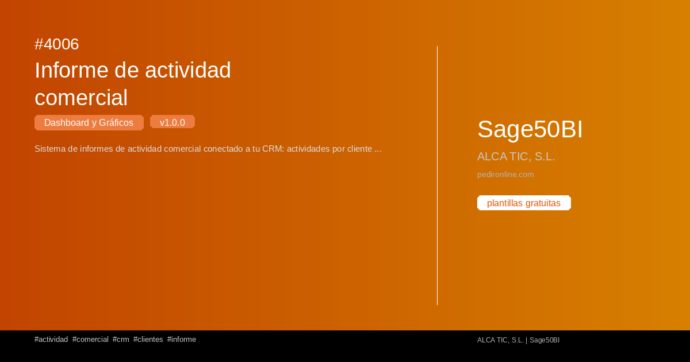](plantillas/4006-informe-de-actividad-comercial.md)

### [Informe de actividad comercial](plantillas/4006-informe-de-actividad-comercial.md)
</article>
<article class="sage-carousel__card" markdown="1">
[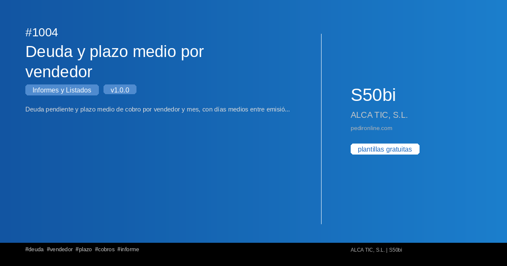](plantillas/1004-deuda-y-plazo-medio-por-vendedor.md)

### [Deuda y plazo medio por vendedor](plantillas/1004-deuda-y-plazo-medio-por-vendedor.md)
</article>
<article class="sage-carousel__card" markdown="1">
[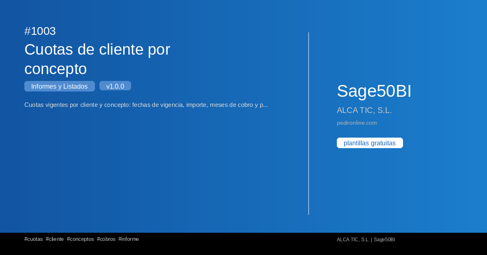](plantillas/1003-cuotas-de-cliente-por-concepto.md)

### [Cuotas de cliente por concepto](plantillas/1003-cuotas-de-cliente-por-concepto.md)
</article>
<article class="sage-carousel__card" markdown="1">
[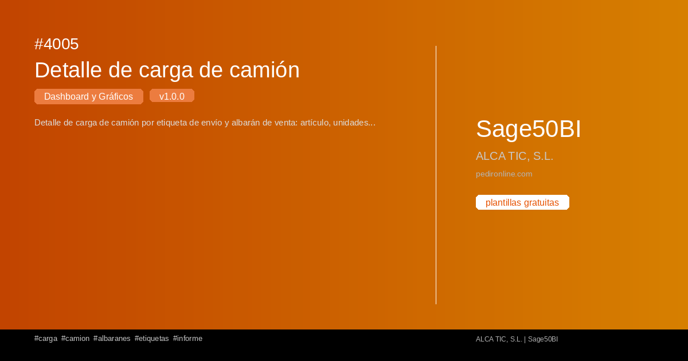](plantillas/4005-detalle-de-carga-de-camion.md)

### [Detalle de carga de camión](plantillas/4005-detalle-de-carga-de-camion.md)
</article>
<article class="sage-carousel__card" markdown="1">
[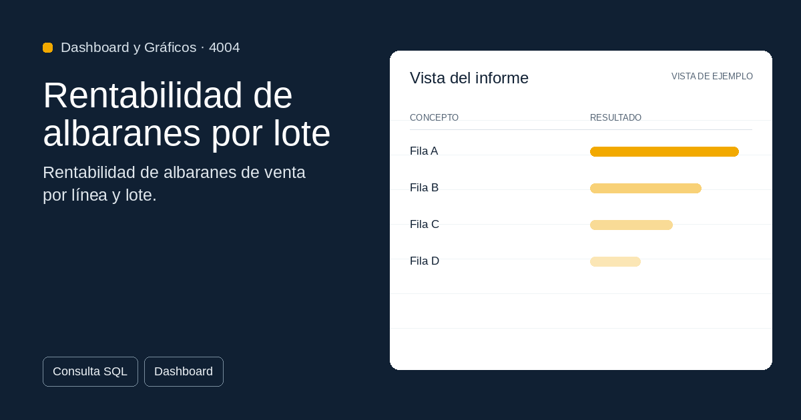](plantillas/4004-rentabilidad-de-albaranes-por-lote.md)

### [Rentabilidad de albaranes por lote](plantillas/4004-rentabilidad-de-albaranes-por-lote.md)
</article>
<article class="sage-carousel__card" markdown="1">
[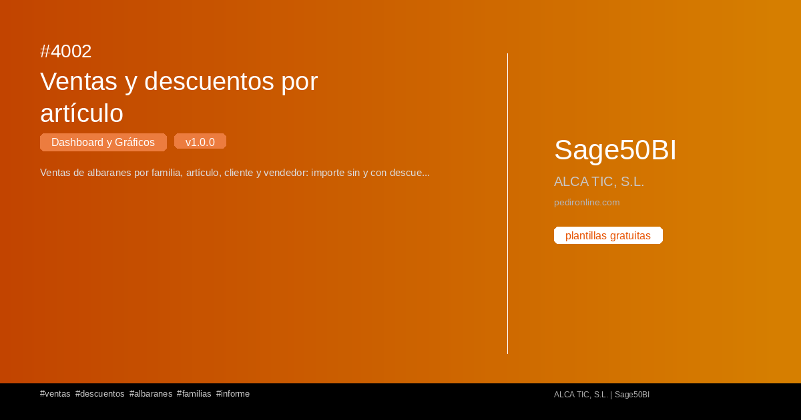](plantillas/4002-ventas-y-descuentos-por-articulo.md)

### [Ventas y descuentos por artículo](plantillas/4002-ventas-y-descuentos-por-articulo.md)
</article>
<article class="sage-carousel__card" markdown="1">
[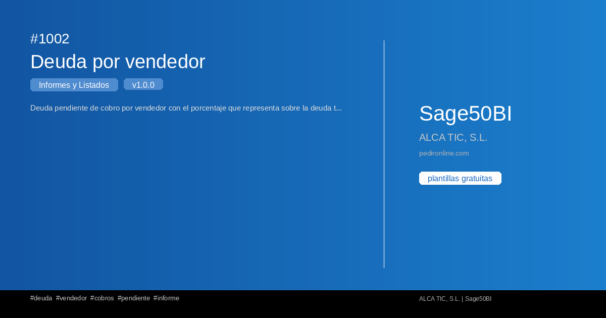](plantillas/1002-deuda-por-vendedor.md)

### [Deuda por vendedor](plantillas/1002-deuda-por-vendedor.md)
</article>
<article class="sage-carousel__card" markdown="1">
[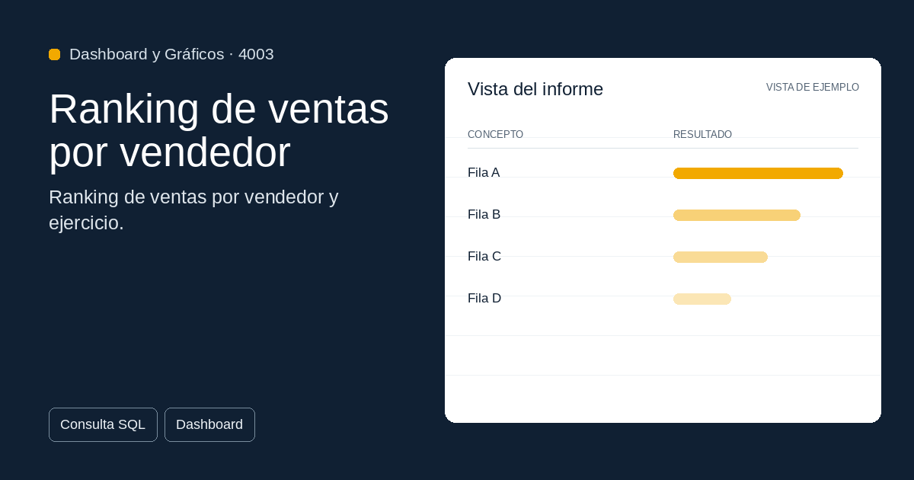](plantillas/4003-ranking-de-ventas-por-vendedor.md)

### [Ranking de ventas por vendedor](plantillas/4003-ranking-de-ventas-por-vendedor.md)
</article>
<article class="sage-carousel__card" markdown="1">

### [Carga de camión](plantillas/4001-carga-de-camion.md)
</article>
<article class="sage-carousel__card" markdown="1">
[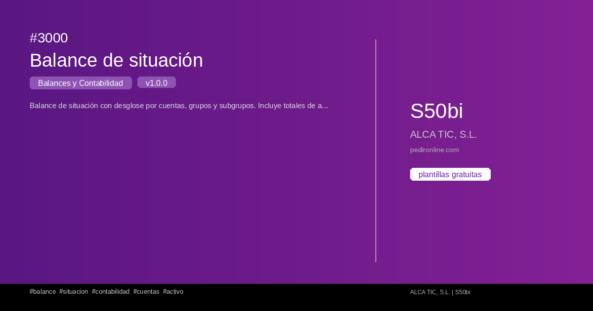](plantillas/3000-balance-de-situacion.md)

### [Balance de situación](plantillas/3000-balance-de-situacion.md)
</article>
<article class="sage-carousel__card" markdown="1">
[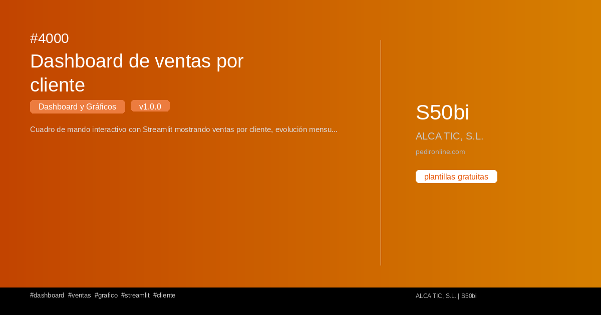](plantillas/4000-dashboard-de-ventas-por-cliente.md)

### [Dashboard de ventas por cliente](plantillas/4000-dashboard-de-ventas-por-cliente.md)
</article>
<article class="sage-carousel__card" markdown="1">
[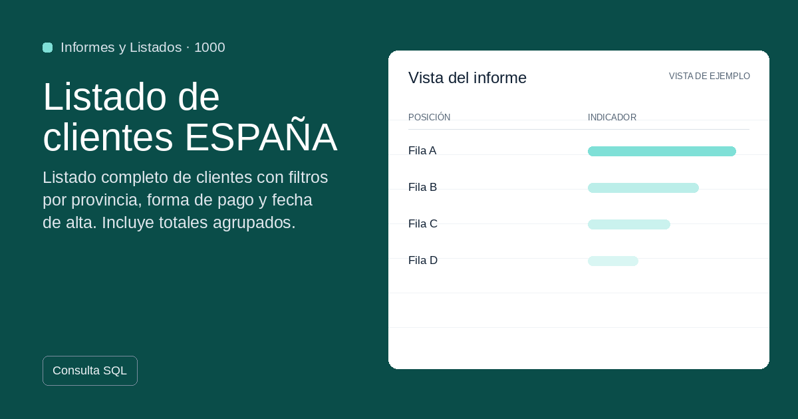](plantillas/1000-listado-de-clientes-espana.md)

### [Listado de clientes ESPAÑA](plantillas/1000-listado-de-clientes-espana.md)
</article>
<article class="sage-carousel__card" markdown="1">

### [Modelo de factura con totales](plantillas/2000-modelo-de-factura-con-totales.md)
</article>
<article class="sage-carousel__card" markdown="1">

### [Listado de proveedores por provincia](plantillas/1001-listado-de-proveedores-por-provincia.md)
</article>

</section>

<section class="sage-section sage-section--business" markdown="1">
## Qué resuelve

<a class="sage-business-tile" href="categorias/informes-listados.md">
1000-1999
<strong>Ventas</strong>
Detecta clientes, artículos y operaciones que necesitan seguimiento comercial.
</a>
<a class="sage-business-tile" href="categorias/facturas-documentos.md">
2000-2999
<strong>Facturación</strong>
Revisa documentos, vencimientos e importes sin reconstruir informes a mano.
</a>
<a class="sage-business-tile" href="categorias/balances-contabilidad.md">
3000-3999
<strong>Contabilidad</strong>
Consulta balances y señales financieras con una lectura más directa.
</a>
<a class="sage-business-tile" href="categorias/dashboards-graficos.md">
4000-4999
<strong>Dashboards</strong>
Convierte consultas en paneles visuales para dirección, administración y equipos.
</a>
<a class="sage-business-tile" href="categorias/crm-ssm.md">
5000-5999
<strong>CRM SSM</strong>
Sigue la actividad comercial y las relaciones con clientes desde S50bi.
</a>

</section>

<section class="sage-section" markdown="1">
## Plantillas recomendadas para empezar

Empieza por estas plantillas y comprueba si resuelven tu necesidad antes de pedir una adaptación.

<article class="sage-featured-card" markdown="1">
#1004
### [Deuda y plazo medio por vendedor](plantillas/1004-deuda-y-plazo-medio-por-vendedor.md)

Informes y Listados

Deuda pendiente y plazo medio de cobro por vendedor y mes, con días medios entre emisión y cobro.

[**Ver detalle**](plantillas/1004-deuda-y-plazo-medio-por-vendedor.md)
</article>
<article class="sage-featured-card" markdown="1">
#2000
### [Modelo de factura con totales](plantillas/2000-modelo-de-factura-con-totales.md)

Facturas y Documentos

Modelo de factura profesional con desglose de líneas, IVA, retenciones y totales. Formato optimizado para impresión.

[**Ver detalle**](plantillas/2000-modelo-de-factura-con-totales.md)
</article>
<article class="sage-featured-card" markdown="1">
#3000
### [Balance de situación](plantillas/3000-balance-de-situacion.md)

Balances y Contabilidad

Balance de situación con desglose por cuentas, grupos y subgrupos. Incluye totales de activo, pasivo y patrimonio neto.

[**Ver detalle**](plantillas/3000-balance-de-situacion.md)
</article>
<article class="sage-featured-card" markdown="1">
#4006
### [Informe de actividad comercial](plantillas/4006-informe-de-actividad-comercial.md)

Dashboard y Gráficos

Sistema de informes de actividad comercial conectado a tu CRM: actividades por cliente y comercial con login por comercial y super...

[**Ver detalle**](plantillas/4006-informe-de-actividad-comercial.md)
</article>

</section>

<section class="sage-section sage-section--packs" markdown="1">
## Packs destacados

Agrupa plantillas por flujo de trabajo para instalar varias piezas coherentes a la vez.

<article class="sage-pack-card" markdown="1">
### [Pack Contabilidad Completa](packs/pack-contabilidad-completa.md)

Balances y dashboard.

2 plantillas
</article>
<article class="sage-pack-card" markdown="1">
### [Pack Gestión Comercial](packs/pack-gestion-comercial.md)

Todo lo que necesitas para gestionar clientes, proveedores y facturas en S50bi.

3 plantillas
</article>

</section>

<section class="sage-section sage-section--technical" markdown="1">
## Catálogo técnico: últimas plantillas

La documentación técnica sigue disponible: versión, categoría y descripción corta de las últimas publicaciones.

| # | Plantilla | Área | Versión | Descripción |
|---|-----------|-----------|---------|-------------|
| 4006 | [Informe de actividad comercial](plantillas/4006-informe-de-actividad-comercial.md) |  Dashboard y Gráficos | 1.0.0 | Sistema de informes de actividad comercial conectado a tu CR... |
| 1004 | [Deuda y plazo medio por vendedor](plantillas/1004-deuda-y-plazo-medio-por-vendedor.md) |  Informes y Listados | 1.0.0 | Deuda pendiente y plazo medio de cobro por vendedor y mes, c... |
| 1003 | [Cuotas de cliente por concepto](plantillas/1003-cuotas-de-cliente-por-concepto.md) |  Informes y Listados | 1.0.0 | Cuotas vigentes por cliente y concepto: fechas de vigencia, ... |
| 4005 | [Detalle de carga de camión](plantillas/4005-detalle-de-carga-de-camion.md) |  Dashboard y Gráficos | 1.0.0 | Detalle de carga de camión por etiqueta de envío y albarán d... |
| 4004 | [Rentabilidad de albaranes por lote](plantillas/4004-rentabilidad-de-albaranes-por-lote.md) |  Dashboard y Gráficos | 1.0.0 | Rentabilidad de albaranes de venta por línea y lote: importe... |
| 4002 | [Ventas y descuentos por artículo](plantillas/4002-ventas-y-descuentos-por-articulo.md) |  Dashboard y Gráficos | 1.0.0 | Ventas de albaranes por familia, artículo, cliente y vendedo... |
</section>

<section class="sage-section sage-section--split" markdown="1">

## Explorar por área

Entra por el área que quieras mejorar primero y baja al detalle de cada plantilla.

| Icono | Área | Rango |
|-------|-----------|-------|
|  | [Informes y Listados](categorias/informes-listados.md) | 1000-1999 |
|  | [Facturas y Documentos](categorias/facturas-documentos.md) | 2000-2999 |
|  | [Balances y Contabilidad](categorias/balances-contabilidad.md) | 3000-3999 |
|  | [Dashboard y Gráficos](categorias/dashboards-graficos.md) | 4000-4999 |
|  | [CRM SSM](categorias/crm-ssm.md) | 5000-5999 |

## Cómo funciona

<article class="sage-step" markdown="1">
1
### Instala S50bi

Si aún no tienes S50bi instalado en Sage 50, instálalo antes de elegir una plantilla. [Descargar S50bi](https://apps.microsoft.com/detail/9n2r7nqkv7xh?hl=es-ES&gl=ES)
</article>
<article class="sage-step" markdown="1">
2
### Elige

Explora el catálogo público o parte de una plantilla recomendada.
</article>
<article class="sage-step" markdown="1">
3
### Instala

S50bi lee el manifiesto del repositorio, descarga la plantilla cifrada y la deja lista para usar.
</article>
<article class="sage-step" markdown="1">
4
### Adapta

Adaptamos consultas, dashboards y packs a las necesidades concretas de tu empresa.
</article>

</section>

<section class="sage-contact" id="contacto" markdown="1">
## ¿Quieres verlo aplicado a tu Sage 50?

Solicita una adaptación a medida cuando tus informes o dashboards necesiten un ajuste propio.

<a class="sage-button sage-button--primary" href="como-cargar.md">Solicitar una adaptación a medida</a>
</section>

*Última actualización: 2026-11-05*
