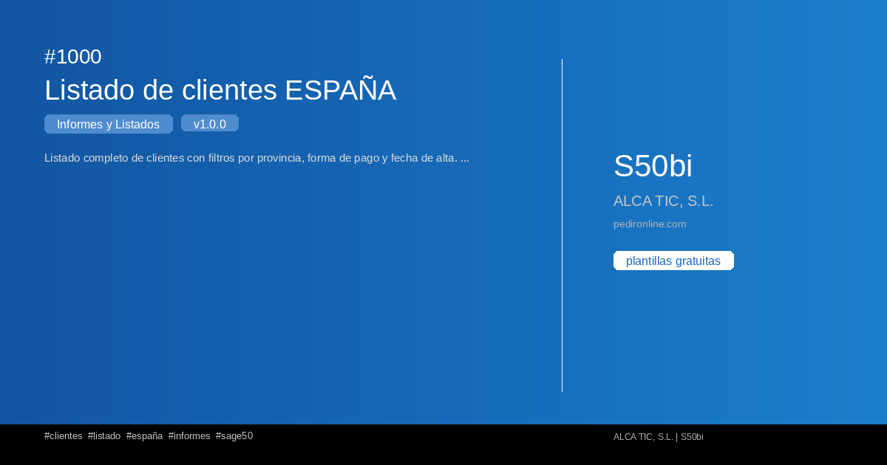

#  1000 - Listado de clientes ESPAÑA

{ width=1200 height=630 }

## Descripción

Listado completo de clientes con filtros por provincia, forma de pago y fecha de alta. Incluye totales agrupados.

## Detalles

| Campo | Valor |
|-------|-------|
| Versión | 1.0.0 |
| Categoría |  Informes y Listados |
| Incluye | SQL |
| Gratuito | ✅ Sí |
| Actualizado | 2026-04-07 |

## Tags

`clientes` `listado` `españa` `informes` `sage50`

## Historial de cambios

### v1.0.0 (2026-04-07)
- Versión inicial

<nav class="sage-dock" aria-label="Acciones de la plantilla">
<a class="sage-dock__action sage-dock__action--use" href="https://apps.microsoft.com/detail/9n2r7nqkv7xh?hl=es-ES&amp;gl=ES" target="_blank" rel="noopener" title="Abre la ficha de S50bi en Microsoft Store (nueva pestaña)"><svg class="sage-dock__icon" viewBox="0 0 24 24" aria-hidden="true" focusable="false"><path d="M8 5.5v13l10.5-6.5z" fill="currentColor"/></svg>Úsalo ahora en S50bi</a>
<a class="sage-dock__action sage-dock__action--improve" href="https://github.com/alfonsoautomatiza/repositorio_Plantillas_SA50bi/issues/new?title=Mejora%3A+1000+%E2%80%94+Listado+de+clientes+ESPA%C3%91A&amp;labels=plantilla&amp;body=Plantilla%3A+1000+%E2%80%94+Listado+de+clientes+ESPA%C3%91A%0AFicha%3A+https%3A%2F%2Fplantillas.alfonsoautomatiza.com%2Fplantillas%2F1000-listado-de-clientes-espana%2F%0A%0A%C2%BFQu%C3%A9+mejora+necesitas%3F%0A%0A%C2%BFPara+qu%C3%A9+la+usar%C3%ADas+en+tu+empresa%3F%0A" target="_blank" rel="noopener" title="Abre una petición de mejora en GitHub (nueva pestaña)"><svg class="sage-dock__icon" viewBox="0 0 24 24" aria-hidden="true" focusable="false" fill="none" stroke="currentColor" stroke-width="2" stroke-linecap="round" stroke-linejoin="round"><path d="M4 20h4L19 9a2.8 2.8 0 0 0-4-4L4 16z"/><path d="M13.5 6.5l4 4"/></svg>Solicitar mejoras</a>
</nav>
