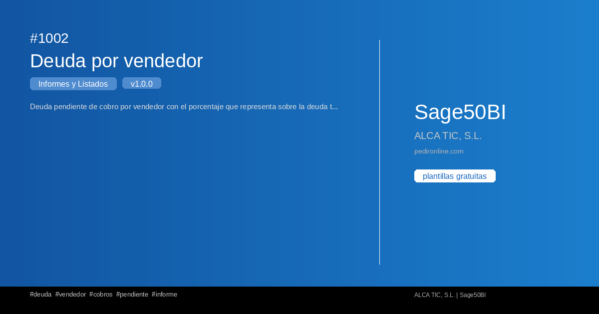

#  1002 - Deuda por vendedor

{ width=1200 height=630 }

## Descripció

📋 Deuda por vendedor

Deuda pendiente de cobro por vendedor con el porcentaje que representa sobre la deuda total de la empresa.

Este informe de S50bi te permite obtener un listado completo con filtros 
personalizables y exportación a Excel.

✅ Gratuita ✅ Actualització automática ✅ Sin registro

## Detalls

| Camp | Valor |
|-------|-------|
| Versió | 1.0.0 |
| Categoria |  Informes i Llistats |
| Inclou | SQL + Dashboard Streamlit |
| Gratuït | ✅ Sí |
| Actualitzat | 2026-11-03 |

## Tags

`deuda` `vendedor` `cobros` `pendiente` `informe`

## Historial de canvis

### v1.0.0 (2026-11-03)
- Versió inicial
