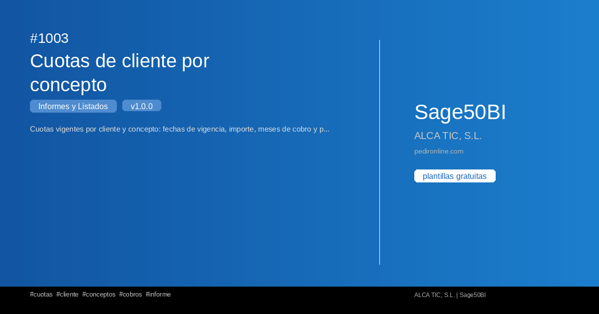

#  1003 - Cuotas de cliente por concepto

{ width=1200 height=630 }

## Descripció

📋 Cuotas de cliente por concepto

Cuotas vigentes por cliente y concepto: fechas de vigencia, importe, meses de cobro y periodicidad en meses.

Este informe de S50bi te permite obtener un listado completo con filtros 
personalizables y exportación a Excel.

✅ Gratuita ✅ Actualització automática ✅ Sin registro

## Detalls

| Camp | Valor |
|-------|-------|
| Versió | 1.0.0 |
| Categoria |  Informes i Llistats |
| Inclou | SQL + Dashboard Streamlit |
| Gratuït | ✅ Sí |
| Actualitzat | 2026-11-03 |

## Tags

`cuotas` `cliente` `conceptos` `cobros` `informe`

## Historial de canvis

### v1.0.0 (2026-11-03)
- Versió inicial
