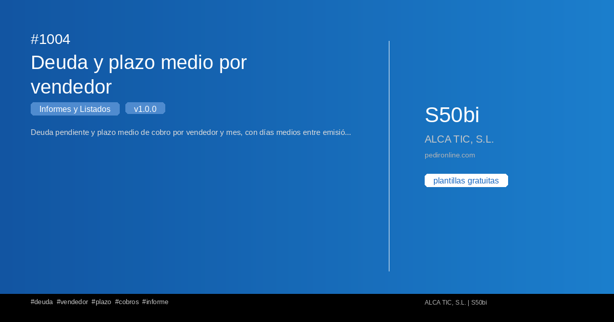

#  1004 - Deuda y plazo medio por vendedor

{ width=1200 height=630 }

## Descripció

📋 Deuda y plazo medio por vendedor

Deuda pendiente y plazo medio de cobro por vendedor y mes, con días medios entre emisión y cobro.

Este informe de S50bi te permite obtener un listado completo con filtros 
personalizables y exportación a Excel.

✅ Gratuita ✅ Actualització automática ✅ Sin registro

## Detalls

| Camp | Valor |
|-------|-------|
| Versió | 1.0.0 |
| Categoria |  Informes i Llistats |
| Inclou | SQL + Dashboard Streamlit |
| Gratuït | ✅ Sí |
| Actualitzat | 2026-11-03 |

## Tags

`deuda` `vendedor` `plazo` `cobros` `informe`

## Historial de canvis

### v1.0.0 (2026-11-03)
- Versió inicial

<nav class="sage-dock" aria-label="Accions de la plantilla">
<a class="sage-dock__action sage-dock__action--use" href="https://apps.microsoft.com/detail/9n2r7nqkv7xh?hl=ca-ES&amp;gl=ES" target="_blank" rel="noopener" data-store-app="ms-windows-store://pdp/?productid=9N2R7NQKV7XH" aria-label="Fes-la servir ara a S50bi" title="Obre la fitxa de S50bi a Microsoft Store (pestanya nova)"><svg class="sage-dock__icon" width="18" height="18" viewBox="0 0 24 24" aria-hidden="true" focusable="false"><path d="M8 5.5v13l10.5-6.5z" fill="currentColor"/></svg>Fes-la servir ara a S50biUsar a S50bi</a>
<a class="sage-dock__action sage-dock__action--improve" href="https://github.com/alfonsoautomatiza/repositorio_Plantillas_SA50bi/issues/new?title=Millora%3A+1004+%E2%80%94+Deuda+y+plazo+medio+por+vendedor&amp;labels=plantilla&amp;body=Plantilla%3A+1004+%E2%80%94+Deuda+y+plazo+medio+por+vendedor%0AFitxa%3A+https%3A%2F%2Fplantillas.alfonsoautomatiza.com%2Fplantillas%2F1004-deuda-y-plazo-medio-por-vendedor%2F%0A%0AQuina+millora+necessites%3F%0A%0APer+a+qu%C3%A8+la+faries+servir+a+la+teva+empresa%3F%0A" target="_blank" rel="noopener" aria-label="Sol·licitar millores" title="Obre una petició de millora a GitHub (pestanya nova)"><svg class="sage-dock__icon" width="18" height="18" viewBox="0 0 24 24" aria-hidden="true" focusable="false" fill="none" stroke="currentColor" stroke-width="2" stroke-linecap="round" stroke-linejoin="round"><path d="M4 20h4L19 9a2.8 2.8 0 0 0-4-4L4 16z"/><path d="M13.5 6.5l4 4"/></svg>Sol·licitar milloresDemanar millores</a>
</nav>

