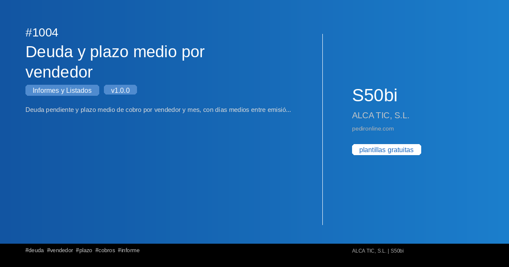

#  1004 - Deuda y plazo medio por vendedor

{ width=1200 height=630 }

## Descripción

📋 Deuda y plazo medio por vendedor

Deuda pendiente y plazo medio de cobro por vendedor y mes, con días medios entre emisión y cobro.

Este informe de Sage50BI te permite obtener un listado completo con filtros 
personalizables y exportación a Excel.

✅ Gratuita ✅ Actualización automática ✅ Sin registro

## Detalles

| Campo | Valor |
|-------|-------|
| Versión | 1.0.0 |
| Categoría |  Informes y Listados |
| Incluye | SQL + Dashboard Streamlit |
| Gratuito | ✅ Sí |
| Actualizado | 2026-11-03 |

## Tags

`deuda` `vendedor` `plazo` `cobros` `informe`

## Historial de cambios

### v1.0.0 (2026-11-03)
- Versión inicial
