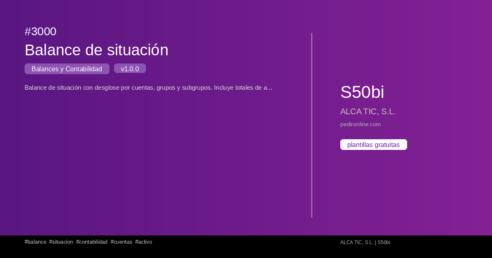

#  3000 - Balance de situación

{ width=1200 height=630 }

## Descripció

Balance de situación con desglose por cuentas, grupos y subgrupos. Inclou totales de activo, pasivo y patrimonio neto.

## Detalls

| Camp | Valor |
|-------|-------|
| Versió | 1.0.0 |
| Categoria |  Balanços i Comptabilitat |
| Inclou | SQL |
| Gratuït | ✅ Sí |
| Actualitzat | 2026-04-07 |

## Tags

`balance` `situacion` `contabilidad` `cuentas` `activo` `pasivo`

## Historial de canvis

### v1.0.0 (2026-04-07)
- Versió inicial
