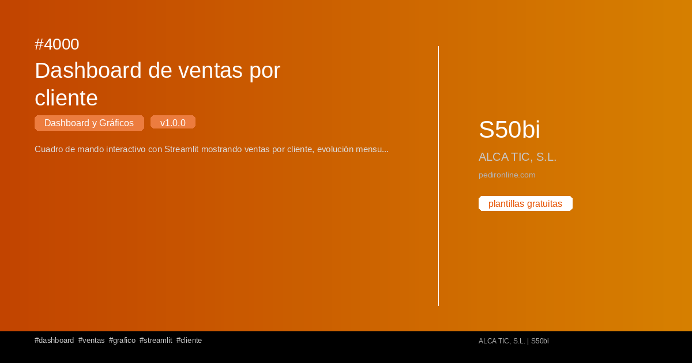

#  4000 - Dashboard de ventas por cliente

{ width=1200 height=630 }

## Descripción

Cuadro de mando interactivo con Streamlit mostrando ventas por cliente, evolución mensual y top 10 clientes. Incluye gráficos de barras y líneas.

## Detalles

| Campo | Valor |
|-------|-------|
| Versión | 1.0.0 |
| Categoría |  Dashboard y Gráficos |
| Incluye | SQL |
| Gratuito | ✅ Sí |
| Actualizado | 2026-04-07 |

## Tags

`dashboard` `ventas` `grafico` `streamlit` `cliente`

## Historial de cambios

### v1.0.0 (2026-04-07)
- Versión inicial
