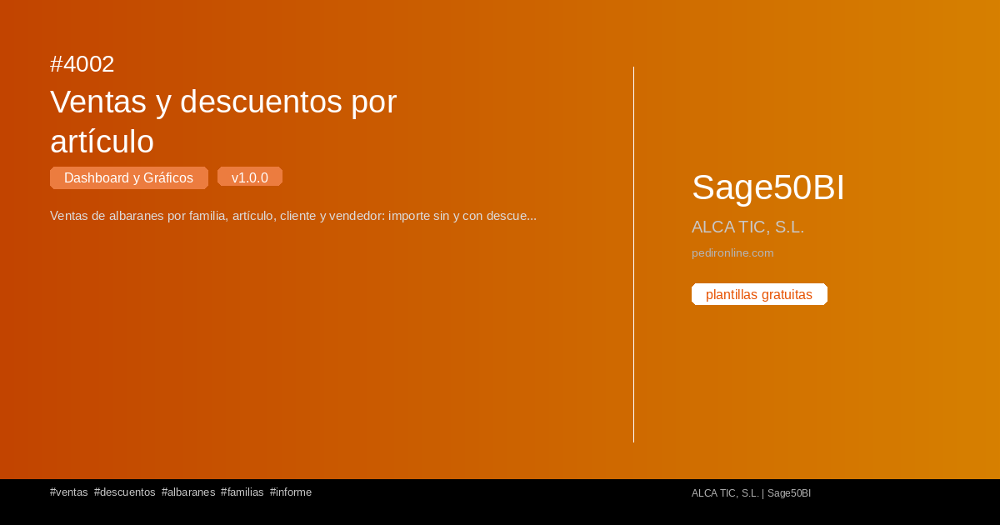

#  4002 - Ventas y descuentos por artículo

{ width=1200 height=630 }

## Descripción

📈 Ventas y descuentos por artículo

Ventas de albaranes por familia, artículo, cliente y vendedor: importe sin y con descuento, descuento medio ponderado y descuento en euros.

Cuadro de mando interactivo con Streamlit para S50bi. Visualiza 
tus datos en tiempo real con gráficos dinámicos.

✅ Gratuita ✅ Actualización automática ✅ Sin registro

## Detalles

| Campo | Valor |
|-------|-------|
| Versión | 1.0.0 |
| Categoría |  Dashboard y Gráficos |
| Incluye | SQL + Dashboard Streamlit |
| Gratuito | ✅ Sí |
| Actualizado | 2026-11-03 |

## Tags

`ventas` `descuentos` `albaranes` `familias` `informe`

## Historial de cambios

### v1.0.0 (2026-11-03)
- Versión inicial
