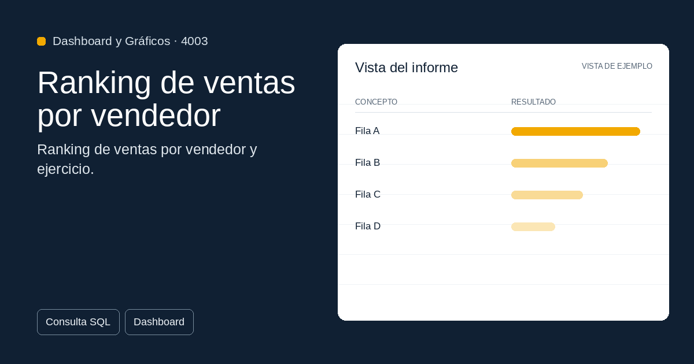

#  4003 - Ranking de ventas por vendedor

{ width=1200 height=630 }

## Descripción

📈 Ranking de ventas por vendedor

Ranking de ventas por vendedor y ejercicio: pedidos, albaranes y total vendido sin IVA con posición por importe.

Cuadro de mando interactivo con Streamlit para Sage50BI. Visualiza 
tus datos en tiempo real con gráficos dinámicos.

✅ Gratuita ✅ Actualización automática ✅ Sin registro

## Detalles

| Campo | Valor |
|-------|-------|
| Versión | 1.0.0 |
| Categoría |  Dashboard y Gráficos |
| Incluye | SQL + Dashboard Streamlit |
| Gratuito | ✅ Sí |
| Actualizado | 2026-11-03 |

## Tags

`ventas` `vendedores` `ranking` `pedidos` `informe`

## Historial de cambios

### v1.0.0 (2026-11-03)
- Versión inicial
