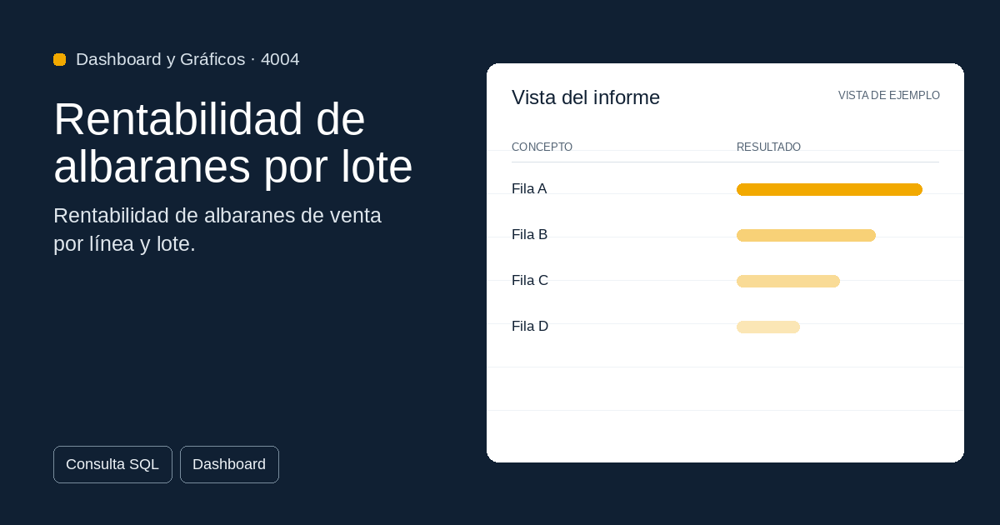

#  4004 - Rentabilidad de albaranes por lote

{ width=1200 height=630 }

## Descripció

📈 Rentabilidad de albaranes por lote

Rentabilidad de albaranes de venta por línea y lote: importes, coste, beneficio y coste prorrateado por lote según peso o unidades.

Cuadro de mando interactivo con Streamlit per a S50bi. Visualiza 
tus datos en tiempo real con gráficos dinámicos.

✅ Gratuita ✅ Actualització automática ✅ Sin registro

## Detalls

| Camp | Valor |
|-------|-------|
| Versió | 1.0.0 |
| Categoria |  Tauler i Gràfics |
| Inclou | SQL + Dashboard Streamlit |
| Gratuït | ✅ Sí |
| Actualitzat | 2026-11-03 |

## Tags

`rentabilidad` `albaranes` `lotes` `costes` `informe`

## Historial de canvis

### v1.0.0 (2026-11-03)
- Versió inicial
