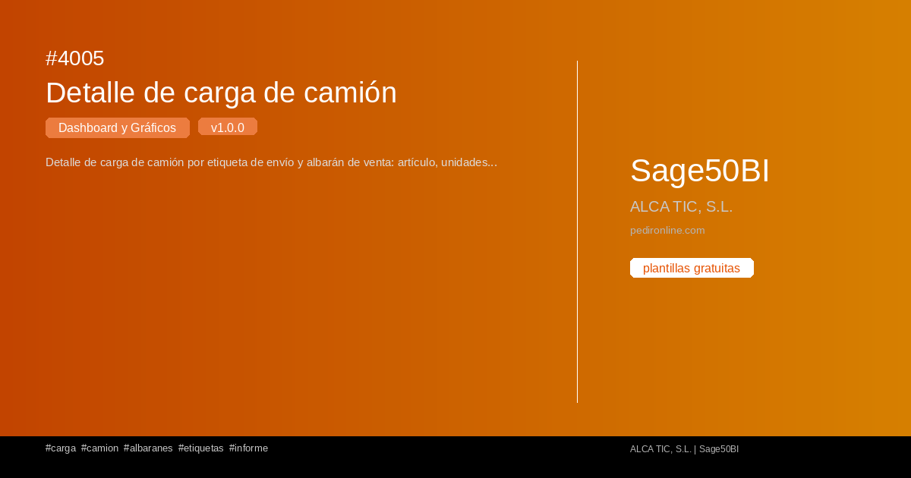

#  4005 - Detalle de carga de camión

{ width=1200 height=630 }

## Descripció

📈 Detalle de carga de camión

Detalle de carga de camión por etiqueta de envío y albarán de venta: artículo, unidades e importe cargado por documento.

Cuadro de mando interactivo con Streamlit per a Sage50BI. Visualiza 
tus datos en tiempo real con gráficos dinámicos.

✅ Gratuita ✅ Actualització automática ✅ Sin registro

## Detalls

| Camp | Valor |
|-------|-------|
| Versió | 1.0.0 |
| Categoria |  Tauler i Gràfics |
| Inclou | SQL + Dashboard Streamlit |
| Gratuït | ✅ Sí |
| Actualitzat | 2026-11-03 |

## Tags

`carga` `camion` `albaranes` `etiquetas` `informe`

## Historial de canvis

### v1.0.0 (2026-11-03)
- Versió inicial
