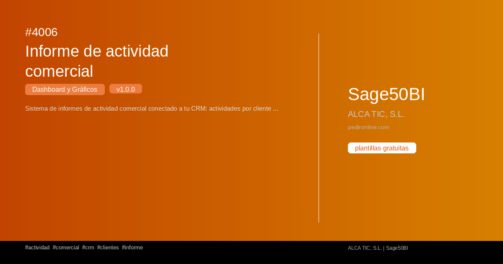

#  4006 - Informe de actividad comercial

{ width=1200 height=630 }

## Descripció

📈 Informe de actividad comercial

Sistema de informes de actividad comercial conectado a tu CRM: actividades por cliente y comercial con login por comercial y supervisor, filtros de fecha, métricas, análisis, gráficos y exportación a CSV, TXT y PDF.

Cuadro de mando interactivo con Streamlit per a Sage50BI. Visualiza 
tus datos en tiempo real con gráficos dinámicos.

✅ Gratuita ✅ Actualització automática ✅ Sin registro

## Detalls

| Camp | Valor |
|-------|-------|
| Versió | 1.0.0 |
| Categoria |  Tauler i Gràfics |
| Inclou | SQL + Dashboard Streamlit |
| Gratuït | ✅ Sí |
| Actualitzat | 2026-11-03 |

## Tags

`actividad` `comercial` `crm` `clientes` `informe`

## Historial de canvis

### v1.0.0 (2026-11-03)
- Versió inicial
