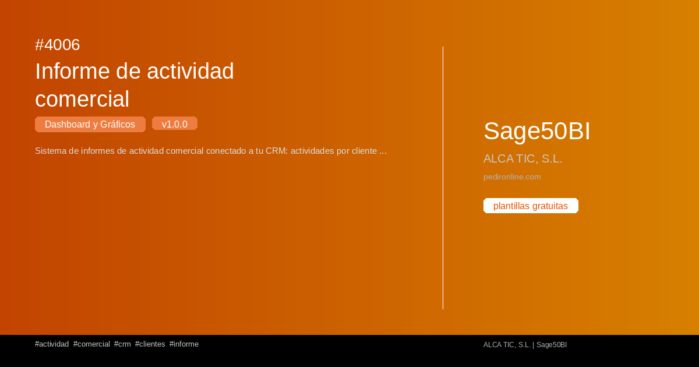

#  4006 - Informe de actividad comercial

{ width=1200 height=630 }

## Descripción

📈 Informe de actividad comercial

Sistema de informes de actividad comercial conectado a tu CRM: actividades por cliente y comercial con login por comercial y supervisor, filtros de fecha, métricas, análisis, gráficos y exportación a CSV, TXT y PDF.

Cuadro de mando interactivo con Streamlit para S50bi. Visualiza 
tus datos en tiempo real con gráficos dinámicos.

✅ Gratuita ✅ Actualización automática ✅ Sin registro

## Detalles

| Campo | Valor |
|-------|-------|
| Versión | 1.0.0 |
| Categoría |  Dashboard y Gráficos |
| Incluye | SQL + Dashboard Streamlit |
| Gratuito | ✅ Sí |
| Actualizado | 2026-11-03 |

## Tags

`actividad` `comercial` `crm` `clientes` `informe`

## Historial de cambios

### v1.0.0 (2026-11-03)
- Versión inicial
