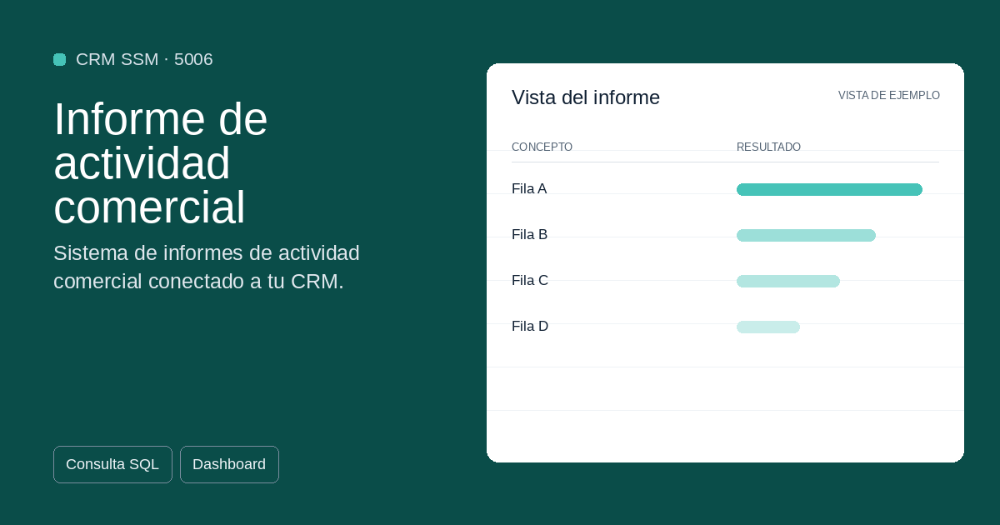

#  5006 - Informe de actividad comercial

{ width=1200 height=630 }

## Descripción

📈 Informe de actividad comercial

Sistema de informes de actividad comercial conectado a tu CRM: actividades por cliente y comercial con login por comercial y supervisor, filtros de fecha, métricas, análisis, gráficos y exportación a CSV, TXT y PDF.

Cuadro de mando interactivo con Streamlit para S50bi. Visualiza 
tus datos en tiempo real con gráficos dinámicos.

✅ Gratuita ✅ Actualización automática ✅ Sin registro

## Detalles

| Campo | Valor |
|-------|-------|
| Versión | 1.0.0 |
| Categoría |  CRM SSM |
| Incluye | SQL + Dashboard Streamlit |
| Gratuito | ✅ Sí |
| Actualizado | 2026-11-03 |

## Tags

`actividad` `comercial` `crm` `clientes` `informe`

## Historial de cambios

### v1.0.0 (2026-11-03)
- Versión inicial

<nav class="sage-dock" aria-label="Acciones de la plantilla">

Pégalo en S50bi &gt; Plantillas<strong class="sage-dock__code-value">5006</strong><button class="sage-dock__action sage-dock__action--copy" type="button" data-template-code="5006" data-copied-label="Código copiado" aria-label="Copiar código" title="Copiar código">Copiar código</button>

<a class="sage-dock__action sage-dock__action--use" href="https://apps.microsoft.com/detail/9n2r7nqkv7xh?hl=es-ES&amp;gl=ES" target="_blank" rel="noopener" data-store-app="ms-windows-store://pdp/?productid=9N2R7NQKV7XH" aria-label="Úsalo ahora en S50bi" title="Abre la ficha de S50bi en Microsoft Store (nueva pestaña)"><svg class="sage-dock__icon" width="18" height="18" viewBox="0 0 24 24" aria-hidden="true" focusable="false"><path d="M8 5.5v13l10.5-6.5z" fill="currentColor"/></svg>Úsalo ahora en S50biUsar en S50bi</a>
<a class="sage-dock__action sage-dock__action--improve" href="https://github.com/alfonsoautomatiza/repositorio_Plantillas_SA50bi/issues/new?title=Mejora%3A+5006+%E2%80%94+Informe+de+actividad+comercial&amp;labels=plantilla&amp;body=Plantilla%3A+5006+%E2%80%94+Informe+de+actividad+comercial%0AFicha%3A+https%3A%2F%2Fplantillas.alfonsoautomatiza.com%2Fplantillas%2F5006-informe-de-actividad-comercial%2F%0A%0A%C2%BFQu%C3%A9+mejora+necesitas%3F%0A%0A%C2%BFPara+qu%C3%A9+la+usar%C3%ADas+en+tu+empresa%3F%0A" target="_blank" rel="noopener" aria-label="Solicitar mejoras" title="Abre una petición de mejora en GitHub (nueva pestaña)"><svg class="sage-dock__icon" width="18" height="18" viewBox="0 0 24 24" aria-hidden="true" focusable="false" fill="none" stroke="currentColor" stroke-width="2" stroke-linecap="round" stroke-linejoin="round"><path d="M4 20h4L19 9a2.8 2.8 0 0 0-4-4L4 16z"/><path d="M13.5 6.5l4 4"/></svg>Solicitar mejorasPedir mejoras</a>
</nav>

